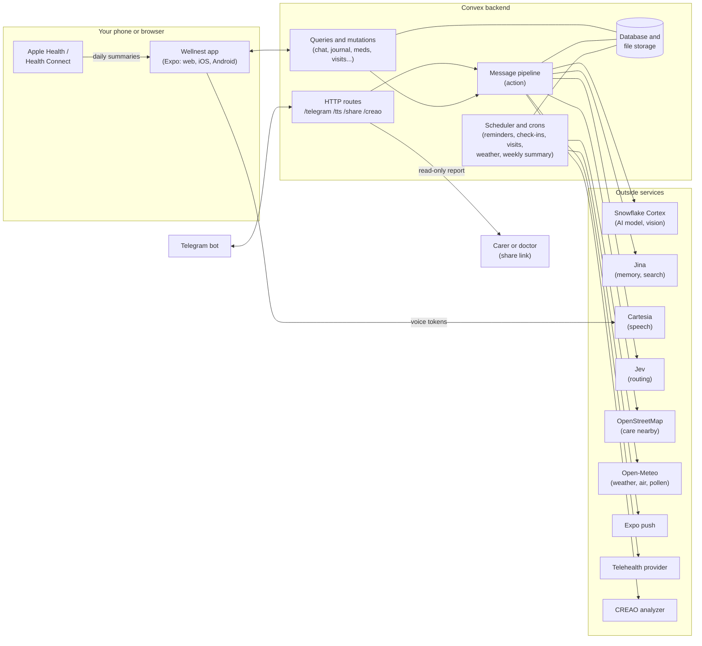
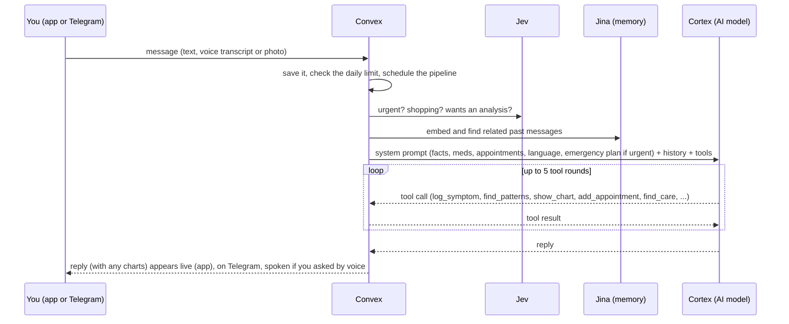
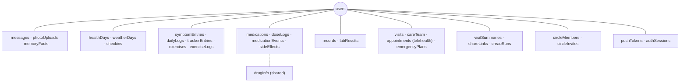
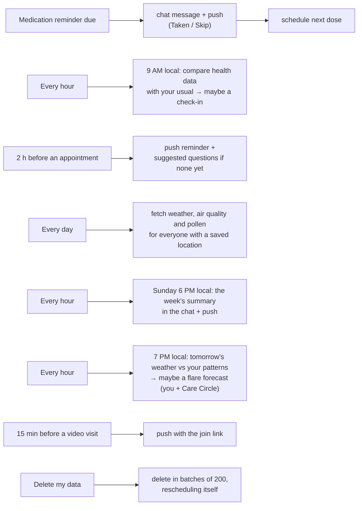

<p align="center">
  
</p>

<p align="center"><b>Your health, in your own words.</b><br>A voice-first AI health companion for the app (web, iPhone, Android) and Telegram.</p>

## What it is
Wellnest is a health companion you can talk to. Tell it how you feel, ask a question, or send a photo of a pill bottle, and it answers in plain language, remembers what matters, and keeps your health story organised so the next doctor's visit is easier. It is not a doctor: anything urgent gets a clear "get care now", the nearest ER and the emergency number.

What it does:
- **Talk or type**, in English, Spanish, Greek or Simplified Chinese, in the app or on Telegram. Replies to spoken questions are spoken back.
- **Remembers you:** past chats, saved facts like allergies, your medications and your appointments.
- **Keeps a journal for you:** symptoms, a daily mood / energy / sleep check-in, pain and CRPS, asthma (peak flow, inhaler use) and seizure trackers, and your exercise routine, logged just by mentioning them in chat.
- **Finds your patterns:** what goes with your worse days (sleep, activity, your cycle, local weather, air pressure, air quality, pollen), how things changed after a new medication or dose, charts right in the chat, a summary of your week every Sunday, and an evening **flare forecast** when tomorrow's weather has gone with your worse days.
- **Reads your wearables:** Apple Health on iPhone and Health Connect on Android (Samsung, Fitbit, Garmin, Oura, Flo...), with gentle check-ins when your numbers change.
- **A tracker first:** the app opens on a dashboard with your next dose, next appointment, today's check-in and four weeks of trends, and a short tour the first time.
- **Medications:** reminders with Taken / Skip, doses as a number and a unit, how to take it, history, side effects, refill warnings and your eScript. Scan the pill bottle to add one (in setup too), print a medication list, see possible interactions from the FDA labels, and get a kind nudge when doses are being missed.
- **Health records:** add a lab report or clinic letter as a photo or PDF; it's explained in plain words in your language and each test is followed over time.
- **Appointments and care team:** reminders, suggested questions to ask based on what changed since your last visit (on the dashboard in the week before), an appointment prep checklist, notes afterwards, one-tap calling.
- **Free tools without an account:** a printable medication list and the appointment prep checklist.
- **Care Circle:** invite family or carers with a one-time link; they see how you're doing (read only) and get the alerts you pick for them.
- **Gets you care:** doctor-ready visit summaries, PDF reports, read-only share links for carers and doctors, an emergency plan, the nearest urgent care / ER / pharmacy, and telehealth video visits booked only when you confirm.
- **Yours to control:** see everything Wellnest knows, export it, or delete it. Light or dark appearance and four text sizes.

## Architecture
The app (Expo / React Native for web, iOS and Android) and the Telegram bot talk to one [Convex](https://convex.dev) backend: database, server functions, scheduler, file storage and HTTP routes. AI and outside services are called from Convex actions, never from the app with secret keys.



### How a message is answered



### Data, grouped by feature



### Things that happen on a schedule



## Layout
- `App.tsx`, `src/` — the Expo app.
  - `Welcome.tsx` — the welcome page before sign-in (`WelcomeSoft.tsx` — its soft look, `soft.tsx` — that look's cards and buttons, `design.ts` — which look shows, `landing.ts` — what both show); `SignIn.tsx`; `Privacy.tsx` — the privacy page (`/privacy`); `route.ts` — that address.
  - `Chat.tsx` — the chat, header, Settings; `HubPanel.tsx` — the **Health tools** screen (dashboard home in `HomePanel.tsx`, then one screen per tool); `ChatHistory.tsx` — the chat history drawer; `Icon.tsx` — one icon per idea.
  - `JournalPanel.tsx`, `DailyCard.tsx`, `TrackersSection.tsx` — symptom journal, daily check-in, pain / asthma / seizure trackers.
  - `InsightsCard.tsx` — patterns and medication before/after; `ChartCard.tsx` — charts under chat replies.
  - `MedicationsPanel.tsx` — medications, reminders, pill bottle scan (`labelScan.ts`), the dose picker (`DoseInput.tsx`), the printable list (`medList.ts`) and the safety card; `GuidesPanel.tsx` — the appointment prep checklist; `Tour.tsx` — the first-time tour; `PublicPages.tsx` — the free tools; `ExercisePanel.tsx` — exercise routine; `RecordsPanel.tsx` — health records.
  - `theme.ts` — light and dark palettes, text size and `themed()` style sheets; `Motion.tsx` — the shared animations.
  - `VisitsPanel.tsx` — appointments and care team; `VisitPanel.tsx`, `ReportCard.tsx`, `ShareCard.tsx` — visit summaries, PDF reports, share links.
  - `CarePanel.tsx`, `EmergencyCard.tsx`, `TelehealthCard.tsx` — care nearby, emergency plan, video visits.
  - `CirclePanel.tsx`, `JoinPrompt.tsx`, `invite.ts` — the Care Circle, joining from an invite link.
  - `health.ios.ts` / `health.android.ts` / `health.ts` + `useHealthSync.ts` + `HealthSettings.tsx` — Apple Health / Health Connect sync.
  - `AboutPanel.tsx` — "What Wellnest knows about me". `push.ts` — notifications. `photo.ts` — photos. `i18n.ts` — English, Spanish, Greek, Simplified Chinese.
  - `useVoice.ts`, `speaker.web.ts` / `speaker.ts` — the mic and spoken replies (see Voice below).
- `convex/` — the backend. `schema.ts` has every table.
  - `pipeline.ts` — the message pipeline and the model's tools; `lib/tools.ts` — tool definitions.
  - `chat.ts`, `telegram.ts`, `http.ts`, `voice.ts` — app API, Telegram, HTTP routes, voice.
  - `journal.ts`, `daily.ts`, `trackers.ts`, `exercises.ts` (+ `lib/journal.ts`, `lib/trackers.ts`) — the journal and trackers.
  - `reminders.ts`, `medications.ts` (+ `lib/reminders.ts`, `lib/meds.ts`) — medications; `drugs.ts`, `medScan.ts` (+ `lib/drugs.ts`) — interactions and label scans.
  - `records.ts`, `recordsPdf.ts` (+ `lib/records.ts`) — health records.
  - `visits.ts`, `telehealth.ts`, `care.ts`, `emergency.ts` — appointments, video visits, care nearby, emergency plans.
  - `visit.ts`, `reports.ts`, `share.ts` (+ `lib/report.ts`) — visit summaries, PDF reports, share links.
  - `health.ts`, `checkins.ts` — wearable data and check-ins. `push.ts` — notifications. `me.ts` — facts, export, deletion.
  - `insights.ts`, `weather.ts`, `weekly.ts`, `forecast.ts`, `questions.ts` (+ `lib/insights.ts`, `lib/insightsText.ts`, `lib/weather.ts`) — patterns, charts, medication before/after, weather triggers, the weekly summary, the flare forecast, questions for appointments.
  - `circle.ts` (+ `lib/circle.ts`, `lib/links.ts`) — the Care Circle; links on the app's domain.
  - `creao.ts`, `shop.ts`, `lib/` — CREAO analysis, the supply shopper, and clients for Cortex, Jina, Cartesia, Telegram, Jev, OpenStreetMap.
- `tests/` — Vitest + convex-test; every outside API is faked.
- `creao/` — the CREAO agent bundle.

## Live
- **Web app:** https://helpful-rat-671.convex.site (also https://talktothebeak.health). Expo web build served by Convex static hosting.
- **Telegram:** [@calhacks2026_bot](https://t.me/calhacks2026_bot) (still pointed at the original hackathon deployment).

## Run
```bash
npm install
npx convex dev          # backend (writes EXPO_PUBLIC_CONVEX_URL to .env.local)
npx expo start --web    # or press i / a for iOS / Android
```
Voice recording, Apple Health / Health Connect, push and PDF sharing need a development build on native (`npx eas-cli build --profile development`), not Expo Go.

```bash
npx vitest run               # tests (outside APIs faked)
npx tsc --noEmit -p .        # app typecheck
npx tsc --noEmit -p convex   # backend typecheck
```

## Convex env vars (`npx convex env set NAME value`)
| Var | What |
|---|---|
| `SNOWFLAKE_ACCOUNT_URL` | `https://<account-identifier>.snowflakecomputing.com` |
| `SNOWFLAKE_PAT` | Snowflake programmatic access token |
| `CORTEX_SHOPPER_MODEL` / `CORTEX_CORE_MODEL` | optional, default `claude-haiku-4-5` / `openai-gpt-5.4` (core must be a Claude/OpenAI model for tools) |
| `CORTEX_VISION_MODEL` | optional; the model for turns with a photo (must accept images; default: the core model) |
| `JINA_API_KEY` | embeddings, search, reader |
| `CARTESIA_API_KEY` | voice (the app's mic and Telegram voice notes); optional `CARTESIA_VOICE_ID` (default: the Sonic voice `db6b0ed5-…`), and `CARTESIA_VOICE_ID_ES` / `CARTESIA_VOICE_ID_EL` for a different voice in Spanish / Greek |
| `TELEGRAM_BOT_TOKEN`, `TELEGRAM_BOT_USERNAME`, `TELEGRAM_WEBHOOK_SECRET` | bot |
| `JWT_PRIVATE_KEY`, `JWKS`, `SITE_URL` | Convex Auth (`npx @convex-dev/auth` sets these) |
| `CREAO_API_KEY` | `capi_...` key from the CREAO agent's page on agent.creao.ai |
| `CREAO_WEBHOOK_SECRET` | any long random string; goes in the webhook URL so only CREAO's callbacks are accepted |
| `CREAO_APP_ID` | optional, defaults to the Symptom & Biosensor Health Analyzer (`4a2f70bf-4da0-422d-a0e2-9c9bc003fd9c`) |
| `JEV_API_KEY` | TypeSafe Jev key; routes each message (optional `JEV_MODEL`, default `jev-latest`) |
| `CORTEX_SHOPPER_MODEL` | optional; the Snowflake model that reads shopping requests (default: the triage model) |
| `TELEHEALTH_PROVIDER` | `test` (default: made-up times, nothing real booked) or `http` with `TELEHEALTH_API_URL`, `TELEHEALTH_API_KEY` and optional `TELEHEALTH_PROVIDER_NAME` |
| `EXPO_ACCESS_TOKEN` | optional; only if Expo's enhanced push security is on |
| `APP_URL` | the public address used in share links and Care Circle invites (`https://talktothebeak.health`); without it, the deployment's `.convex.site` URL |

## Apple Health
The iPhone app reads **daily summaries** from HealthKit and syncs them to `healthDays` (one row per user per local day): steps, active energy, resting heart rate, HRV (SDNN), sleep (asleep time, overlapping watch/phone logs merged), breathing rate, SpO2, sleeping wrist temperature, weight, and menstrual flow. Raw samples never leave the phone. Cycle apps like Flo, Clue and the Health app itself write flow logs to Apple Health, so period data comes along without a Flo integration; Garmin, Oura and Whoop also copy much of their data there.
- **Sync:** Settings → Apple Health → Connect asks iOS for read access and sends the last 90 days. After that the app re-syncs when opened or brought back (at most every 30 minutes): the days since the last sync plus two before, because watch data arrives late.
- **Model:** once connected, the core model gets a `get_health_data` tool (1-90 days). It returns averages, the last 3 days compared to the days before, cycle facts (period starts, cycle day, average length), and one line per day.
- **CREAO:** summaries go to a symptom analysis only if the user turns on "Include in symptom analyses". Then empty `biosensor_data`, `cycle_data` and `last_period_start` fields are filled from the last 14 days (vitals) and 90 days (cycle).
- **Disconnect:** removes the link and deletes every synced day. Web and Android show the status and can disconnect, but can't connect (HealthKit exists only on iPhone).
- **Building:** HealthKit doesn't work in Expo Go. Build a development client with EAS (`eas.json` is set up; needs an Apple Developer account): `npx eas-cli build --profile development --platform ios`, install it on the iPhone, then `npx expo start --dev-client`. The bundle id is `health.talktothebeak.wellnest` (`app.json`); change it if you prefer another.

### Android: Health Connect
On Android the same sync reads **Health Connect** (`src/health.android.ts`), where Samsung Health, Fitbit, Garmin, Oura, Google Fit and cycle apps write their data: steps, active calories, resting heart rate, HRV (RMSSD here; iPhone gives SDNN), sleep sessions minus awake stages, breathing rate, SpO2, weight and menstrual flow. There's no wrist temperature on Android. Rows and the link record `source: "health_connect"`. It needs the Health Connect app (built in from Android 14), a development build, the read permissions listed in `app.json`, and `minSdkVersion` 26 (set with `expo-build-properties`).

## Account setup
After someone signs in for the first time (existing accounts too, once), a short setup runs before the dashboard (`src/Onboarding.tsx`, `convex/onboarding.ts`): language, what to call them with an optional age range and sex, what they use Wellnest for (symptoms, chronic pain / CRPS, asthma, seizures, medications, mood and sleep, general wellness, caring for someone), conditions and allergies (saved as facts), medications with reminder times (typed, or scanned from the pill bottle, and editable or removable once added), emergency contacts (name, phone number and relationship for each, as many as they like up to 10; these are the emergency plan's contacts), their city, connecting Apple Health / Health Connect on phones, and the check-in switches. Every step can be skipped, "Finish later" keeps what's done, answers already on the account start filled in, and Settings has **Redo account setup**. Finishing posts a welcome in the chat the first time, with tips for what they picked.
- **Tour:** then a card at the bottom walks through the real screens (dashboard, journal, medications, health tools, chat, settings), moving the app to each as they tap Next (`src/Tour.tsx`). Skipping or finishing sets `users.touredAt`; Settings has **Show me around again**.
- **Home screen:** the app opens on the dashboard (`src/HomePanel.tsx`), which fills the window with more columns on wider screens; the gear opens Settings from the dashboard or the chat, and moving between them slides sideways. In a browser window 768 px or wider, Settings (and "What Wellnest knows about me") slides in over the right half of the page (`src/SideSheet.tsx`; Escape or a tap outside closes it); on phones it drops open full width under the header.
- **Tailoring:** the model is told their name, age range, sex and focus; the Journal shows the trackers they picked (plus any they've used) with the rest behind "More trackers"; and the empty chat suggests a first message for each thing they picked.

## Doctor-visit summary
A one-page Markdown summary to bring to an appointment: reason, main concerns, a dated timeline, symptoms (onset, frequency, severity, triggers, what helps), medications, notable Apple Health trends, earlier CREAO analyses (labelled AI-generated) and questions to ask. The core model writes it in the patient's voice from **only** the material it's given: the chat for the chosen period (14, 30 or 90 days; store-link messages and anything hidden by Clear chat are left out), completed CREAO reports, Apple Health summaries if connected, and the user's medications.
- **App:** the clipboard button opens the panel: optional reason, period, "Write my summary". The result can be shared (iOS/Android share sheet), printed or saved as PDF (web opens a print-ready page), copied, regenerated or deleted. Only the latest one is shown.
- **Chat:** "prepare me for my doctor's appointment" makes the model call `prepare_visit_summary`. In the app a note says it's ready; on Telegram the summary itself is sent.
- **Limits:** one at a time, 5 a day.

## Medications and reminders
The **Medications** tab shows every medication in its own box (two to a row on phones, three on wider screens, so none is missed going down the list) with its dose, schedule, next dose, days of supply left and whether it's paused or stopped (stopped ones are kept for the history). Tap a box and it spans the row with its details:
- **Dose:** a number and a unit picked from chips (mg, mcg, g, mL, tablets, capsules, puffs, drops, units, patches, sprays, or one typed under Other), saved as one line of text in the user's language ("2 tablets") so older doses still read back (`src/DoseInput.tsx`, `src/dose.ts`).
- **Details:** generic name, form (tablet, inhaler, patch...), prescriber, how to take it ("with food", filled from a label scan), notes, and a **different dose at some times** (e.g. 300 mg in the morning, 600 mg at night); the reminder says the right dose.
- **Medication list:** medicine, strength / dose, when and how it's taken, and notes for every current medication, printed or saved as a PDF (`src/medList.ts`).
- **History:** started, paused, resumed, stopped, dose changes and refills, each dated (`medicationEvents`). Pausing cancels reminders; resuming brings them back.
- **Side effects:** dated, with an optional 0-10 severity (`sideEffects`).
- **Refills:** units on hand and per dose; each **Taken** counts one dose off, and when the supply will run out within the warning window (7 days by default) a chat note and a push say so, once until the next refill.
- **eScript:** a photo of the QR code or prescription label, uploaded like a chat photo and kept with the medication.
- **Chat:** "the new pills make me dizzy", "I stopped my ibuprofen", "my sertraline went up to 100 mg" → `update_medication`. The model sees each medication's details, adherence, dose changes and side effects.

### Medication safety
- **Scan a pill bottle:** **Scan a pill bottle** next to **Add a medication** (and in account setup) reads a photo of a pharmacy bottle, box or inhaler with the vision model (`medScan.read`) and fills in the add form: name, generic name, strength, form, prescriber and how often (twice a day becomes 08:00 and 20:00). The directions line is shown above the form, nothing is saved until **Save**, and the photo is deleted once it's read.
- **Possible interactions:** each medication name is looked up once and shared (`drugInfo`, refreshed after 30 days): RxNorm turns brand names and misspellings into ingredients and brands, and openFDA gives the label's drug interactions, warnings, "ask a doctor or pharmacist" and boxed warning text, with the drug classes. When one medication's label names another one you take (by ingredient, brand or class, such as "NSAIDs"), the **Medication safety** card on the Medications tab shows the pair with the label's own sentence, and a chat message says it once per pair in your language. A brand and its generic aren't counted, and names neither service knows are listed so you can ask a pharmacist. The model sees the same list and is told it's label wording, not a judgement. This isn't a full interaction check, and the app says so.
- **Missed doses:** when a reminder fires and three or more doses of that medication in the last week were skipped or left unanswered for 2 hours, a kind note in chat asks whether a different time would work better, at most once a week per medication.
- **Adherence:** visit summaries and PDF reports already list Taken / Skip for each medication.

### Reminders
Each due dose posts a reminder message in the app chat ("💊 Time for your **Ibuprofen** (400 mg). Due 8:00 PM.") with **Taken** / **Skip** buttons; answers go to `doseLogs` and can be changed. Reminders aren't embedded for memory and aren't read aloud. They're in-app only, not sent on Telegram.
- **Schedules:** daily at set local times (up to 8), or every N hours (1-72) from the first dose; optionally for a course of N days (a dose due at the very end isn't sent). Up to 20 active reminders.
- **Time zones:** the app reports the device's IANA zone (`chat.setTimeZone`) on start; daily times follow it across daylight saving. Until the app has been opened, times are UTC (the model says so). A fixed UTC offset is the fallback if the runtime can't resolve the zone.
- **Scheduling:** one scheduled function per reminder (`fire`), which posts the message and schedules the next dose. Stopping cancels it; stale jobs are ignored.
- **Chat:** "remind me to take ibuprofen 400 mg every 6 hours for 3 days" → `set_medication_reminder`; "stop my ibuprofen reminders" → `cancel_medication_reminder`. Visit summaries and reports get each medication with the last 30 days of Taken / Skip.

## Health records
The **Records** tool (`convex/records.ts`, `src/RecordsPanel.tsx`) keeps lab reports, discharge and clinic letters and imaging reports.
- **Adding one:** a photo (the camera on phones, the library on web) or a PDF, up to 15 MB, uploaded and claimed like a chat photo. It's read in the background: photos go to the vision model; PDFs have their text pulled out first (`recordsPdf.ts`, unpdf in a Node action), and a scanned PDF with no text asks for a photo instead. Up to 3 are read at a time.
- **What comes back:** a title, the date on the record, the lab or clinic, a 2-4 sentence plain-language summary in the user's language, and for labs one `labResults` row per test with the value and unit as printed, the reference range, the report's flag (low, high, abnormal or in range) and one plain sentence on what the test means. Test names are kept in standard English so the same test lines up across reports.
- **Over time:** **Your tests over time** shows a small bar trend for every test seen more than once or out of range, with the usual range as a band and out-of-range values in amber.
- **The model:** sees the latest value of each test (out-of-range first) and the newest letters' summaries, and is told to explain in plain words without diagnosing.
- **Your data:** the original file can be opened again or removed with its results; records have their own row in "What Wellnest knows about me" and are in the export. A note under the list says explanations are AI-written and to check values against the original.
- **Later:** importing from a patient portal (SMART on FHIR).

## Appearance
Settings has **Appearance** (system, light or dark) and **Text size** (four sizes), saved on the account (`chat.setAppearance`). `src/theme.ts` keeps a light and a dark palette checked for WCAG AA contrast; `applyTheme` swaps them in place at the app root, and every style sheet is made with `themed()`, which rebuilds it after a change with font sizes and line heights scaled. On web the page background, `color-scheme` and the slim rounded scroll bars (mint, teal on hover; `public/index.html`) follow it.

**Two looks**, for developers only (people using the app never choose): **soft**, the default, after the "soft" style from Taste Skill (`.claude/skills/soft-skill/`, MIT), and **classic**, the original. `DESIGN` in `src/design.ts` sets it for every build; `EXPO_PUBLIC_DESIGN=classic` (or `soft`) overrides it for one build or dev server; on a local web dev server `?design=classic` or `?design=soft` overrides it for that page load (production builds ignore it). The look is part of the theme (`applyTheme`), so every screen follows it: in the soft look the top bars and the chat's message box float as rounded white panels (the `bar*` colour tokens, `floatingBar()`), corners are rounder (`radius`, `round()`), buttons and chips are pills (`ui.button`, `pillish()`), cards get a wide faint shadow, the small line over a title is in spaced capitals (`kicker()`), and every text style uses Plus Jakarta Sans, bundled with the app and loaded before the first screen (`useSoftFonts`). Words, colours, dark mode, contrast and text size are the same in both.

## Photos
Ask about a photo: a pill bottle, a prescription label, lab results, a rash or a wound.
- **App:** the camera button picks from the library (web) or takes / picks a photo (iOS/Android). It's shrunk to at most 1600px, uploaded to Convex file storage with a one-time upload URL, claimed by the uploader (`chat.claimUpload`), then sent with the message; `send` only accepts the sender's own unused upload of an image under 8 MB. The chat shows the photo in the bubble.
- **Telegram:** photos (the largest size up to 1600px) and images sent as files, with the caption as the question. They're stored the same way, so the app shows them too. Over 8 MB or over the daily limit is refused before downloading.
- **Model:** the photo goes to Cortex as an image content part (a base64 data URL) with that turn only, using `CORTEX_VISION_MODEL` (default: the core model). The system prompt asks it to read labels exactly and say when text is unreadable, to describe skin/wound photos without diagnosing and list what would make them urgent, and never to identify people. Later turns see "[sent a photo]" in the history, not the image.

## What Wellnest knows about me
Settings → **What Wellnest knows about me** shows, in one place:
- **Saved facts:** lasting health facts (allergies, conditions, regular medications...) that go into the system prompt on every turn and into visit summaries. The model saves them with `remember_fact` and removes them with `forget_fact` ("I'm not allergic to penicillin after all"); the user can add, edit and remove them. Up to 50, each labelled "saved by Wellnest" or "added by you".
- **Profile and what's stored:** email, location, time zone, voice and Telegram status, and counts of messages (with the date of the first), photos, symptom analyses, Apple Health days, reminders and Taken / Skip answers, and visit summaries. Counts above 200 show as "200+".
- **Who sees what:** which outside services get which data (Snowflake Cortex, Jina, Cartesia, Jev, CREAO, Telegram).
- **Export:** everything as JSON (messages without embeddings; photos listed by storage id). Web downloads a file; iOS/Android open the share sheet.
- **Delete:** per category (messages with their photos, analyses, check-ins and video visits; health data; medications with their history; the journal with check-ins, trackers and exercises; appointments, care team and emergency plan; visit summaries; health records with their files; saved facts) or **everything**, which also deletes the auth sessions, accounts and the user, then signs out. Rows are deleted in batches of 200 by a self-rescheduling mutation. Clear chat still only hides messages; this is where they're actually deleted.

## Languages
Wellnest speaks **English, Spanish, Greek and Simplified Chinese**. The user picks one in Settings or during account setup, or on Telegram with `/language en|es|el|zh`; a new Telegram user starts in their Telegram app's language if it's one of these.
- **Replies:** the core model is told to answer in that language unless the user writes in another one, using everyday words plus the common name of medical terms.
- **Voice:** Cartesia STT (ink-whisper) and Sonic TTS get the language: the app's token carries it (`voice.token`), and `/tts` and Telegram voice notes read it from the user. One Sonic voice speaks all of them unless `CARTESIA_VOICE_ID_ES` / `_EL` is set. Cut-short speech ends with "the rest is in the text" in that language.
- **Also translated:** medication reminder messages (local time format), visit summaries (written in that language), check-ins, telehealth messages and push notifications, the daily-limit and error replies, and the whole app: chat, Settings, every Health tools tab and "What Wellnest knows about me" (`src/i18n.ts`; the typecheck fails if a language is missing a string). Still English: the sign-in screen (the language isn't known yet), microphone error messages, and error text that comes from the server.

## Push notifications
iOS and Android get push notifications (Expo push) for **medication reminders** (with Taken / Skip buttons right on the notification), **appointment updates** and the **weekly summary**. Reminders and appointments can each be turned off in Settings; the weekly summary's switch turns off both its message and its push.
- **Setup:** push needs a development or store build with an EAS project id (`npx eas-cli init` writes it to `app.json`). Optional `EXPO_ACCESS_TOKEN` on the Convex deployment if you turn on Expo's enhanced push security. Web has no push; reminders still show in the chat.
- **Devices:** each phone registers its token in `pushTokens` (up to 10 per user; a phone that signs in to another account moves to it). Signing out removes it; tokens Expo reports as `DeviceNotRegistered` are dropped.

## Symptom journal
When someone tells Wellnest how a symptom is ("my headache's a 6 today", "cramps were bad yesterday"), the model logs it with `log_symptom`: one entry per symptom per local day (a second report that day updates it), severity 0-10, an optional note. The **Health tools** button (the filled grid icon) opens a dashboard: the next dose and appointment, days logged and doses taken this week, today's check-in, four weeks of charts for what the user tracks (picked by their setup focus, each compared with last week), the strongest pattern and today's weather (`convex/dashboard.ts`). Tiles under it open the Journal, Medications, Exercise, Visits, Reports, Records and Care; inside a tool, the back button returns to the dashboard and the row under the header switches tools.
- **Journal tab:** a severity bar chart per symptom for 14, 30 or 90 days, with Apple Health sleep (dark when under 6 h) and period days underneath; per-symptom summaries (days logged, average, latest, getting better or worse); and patterns such as "Headache averaged 7/10 on days with under 6 h of sleep vs 3/10 otherwise", shown only with at least 3 days on each side and a 1.5-point gap, and labelled as associations, not causes. Bars run from teal for mild through yellow and orange to red for the worst, and the check-in's mood, energy and sleep bars (and the dashboard charts) use the same smooth scale by how good the day was.
- **Log a symptom** (`src/SymptomLog.tsx`), near the top of the Journal: big buttons for what's bothering you (your own recent symptoms first, then common ones, or **Something else** to type it), a 0-10 bar that says the level in words (none, mild, moderate, severe, worst), today or yesterday, an optional note and one **Save** button that names what it will save. Recent entries are listed under it with their level and can be removed.
- **Model and summaries:** `get_symptom_journal` gives the model the same summaries, patterns and entries; visit summaries include them. The journal can be deleted from "What Wellnest knows about me".

## Chat history
The menu button at the top left opens every chat, newest first, named after its first message. **New chat** (the pencil) starts an empty one; tapping an old chat continues it, and the model only sees that chat's messages (long-term memory still searches all of them). Reminders, check-ins and Telegram messages go into whichever chat is open. Deleting a chat deletes its messages (`convex/chats.ts`). Messages from before chats existed have no `chatId` and form the user's first chat. The search box above **New chat** matches titles as you type and anything said in a chat through the `search_text` index on messages (`chats.search`), showing the matching line.

## Patterns and triggers
The Journal tab's **What goes with your worse days** card, and the model's `find_patterns` tool, look through the last 90 days of your own logs (`convex/lib/insights.ts`). Each day becomes one number per measure: pain (the highest that day), your three most-rated symptoms, mood, energy and sleep quality, lowest peak flow, reliever puffs, and seizures (counted as 0 on seizure-free days after the first one). Each is compared with possible triggers: sleep hours and quality, the previous day's steps, resting heart rate, HRV, period days, and local weather (daily high, humidity, a drop in air pressure, rain, air quality index, pollen).
- **How:** split the days at the trigger's median (or yes/no), and keep a pattern only with at least 10 days that have both numbers, 4 on each side, a gap big enough to matter (1 point of pain, half a point of mood) and at least half a standard deviation. The strongest show, two per measure at most, worded like "Pain averaged 6/10 on days with humidity of 65% or more (10 days), vs 2/10 on other days (10)" and labelled as associations, not causes. The older journal patterns (3 days a side) still show until these appear.
- **Medication before and after:** for each medication started or dose changed in the last four months, every measure's average in the two weeks before vs the days after (at least four), when the change matters: "Pain since starting Amitriptyline on Oct 26: 3/10, vs 7/10 in the 2 weeks before (better)."
- **Weather** (`convex/weather.ts`, `lib/weather.ts`): Open-Meteo, free and keyless. Saving a location (Settings, chat or a Telegram location) geocodes it and fetches the last two weeks and the next three days; a daily cron refreshes everyone with a location, rewriting the last two weeks so gaps fill in and forecasts become actual readings. Hourly readings become one row per local day in `weatherDays`, kept about a year. Pollen is only reported in Europe. The card and the dashboard show today's weather with the place it's for ("Weather in Berkeley, California today"): the town and state or country from the map lookup (`users.locationPoint.place`, looked up once more for points saved before it was kept), else the location as typed. The model also gets tomorrow's forecast.

## Flare forecast
At 7 PM local time (`convex/forecast.ts`, hourly cron), Wellnest compares **tomorrow's forecast** with the user's own weather patterns (`findPatterns` limited to heat, humidity, a pressure drop, rain, air quality and pollen; `forecastMatches` in `lib/insights.ts`). When the forecast falls on the worse side of one, it posts a short heads-up in the chat with a push (and on Telegram when linked): "**Forecast: a drop in air pressure.** Pain averaged 6/10 on days with a drop in air pressure (9 days), vs 3/10 on other days (20)", labelled a pattern in their own logs, not a prediction. At most one a day, only with a saved location, at most one line per measure; nothing on days with no match. Care Circle members who chose it get their own copy. The dashboard's insight card shows the same "Tomorrow's heads-up", and the model's `find_patterns` result includes it. Settings → **Evening flare forecast** turns it off. Weather is fetched three days ahead so tomorrow is there even in time zones where the daily fetch lands late.

## Care Circle
**Health tools → Care Circle** (`convex/circle.ts`, `src/CirclePanel.tsx`). The person invites family or carers: a one-time link (`APP_URL/?join=<token>`, 7 days, up to 10 people counting open invites) with a label ("Mom") and the alerts that person gets: **missed doses** (with the person's own missed-dose nudge in `reminders.ts`) and the **flare forecast**. Opening the link before signing in shows whose circle it is on the welcome page; after sign-in and account setup a prompt explains what joining means (`src/JoinPrompt.tsx`). The person sees each member, can change their alerts or remove them, and gets a chat message when someone joins.
- **What members see (read only):** today's doses (taken, skipped, missed after 2 hours, due), active medications, this week against last week for each measure, when something was last logged, tomorrow's flare forecast, emergency contacts with Call buttons, and a full 30-day report (the same page as PDF reports). Members can leave at any time.
- **Alerts** go to the member's own chat (and Telegram when linked) with a push, in the member's language.
- **Deleting** the account removes both sides: the person's members and invites, and the circles they were in. Export includes the circle.

## Welcome page and privacy
Signed out, `src/Welcome.tsx` leads with the tracker and an **example story** (`src/LandingStory.tsx`, data in `src/landing.ts`): four weeks of a made-up person's days that play in as the page opens, in four beats, each something the app really does. Wellnest finds the pattern (bars with the weather days marked), warns about tomorrow, writes the question for the doctor, and shows the change after a medicine. A tab switches between rheumatoid arthritis (joint pain and drops in air pressure) and asthma (reliever puffs and high pollen); with reduced motion the finished picture shows straight away. After that come what else Wellnest does, how it works, the free tools and how data stays the user's, in the browser's or phone's language (with a switch), then sign-in or a new account. `/privacy` (`src/Privacy.tsx`) lists what's kept, the services that process it and the choices people have; it's open signed in or not and linked from "What Wellnest knows about me". `public/index.html` adds the description and link-preview tags for the site and invites.
- **Free tools** (`src/PublicPages.tsx`), open to everyone: `/medication-list` (type medicines, then print or save a PDF; kept only in that browser's storage) and `/appointment-checklist` (the prep checklist, ticks kept in the browser). Each ends with "Create an account", which opens sign-up.
- **Soft welcome page:** in the soft look (see Appearance) the welcome page (`src/WelcomeSoft.tsx`) and the free tools add cards set in a faint tray, pill buttons with the arrow in its own circle (`src/soft.tsx`), small capital tags over headings, more space, and sections that rise in as they scroll into view (`Rise` in `src/Motion.tsx`).
- **Example dashboard** (`/demo`, `src/DemoPage.tsx`): **See an example dashboard** on the welcome page opens the real dashboard (`DashboardView` in `src/HomePanel.tsx`) with four weeks of sample data for a made-up person, made in the browser: charts, the next dose and appointment with questions, today's check-in (the faces can be tapped), a pattern, tomorrow's heads-up and the weather. Nothing is sent to the server or saved; tapping a tool or the chat says it opens with a free account.

## Charts in chat
"Show my pain this month" makes the model call `show_chart` (pain, a symptom, mood, energy, sleep, steps, heart rate, HRV, weight, peak flow, reliever puffs, seizures, temperature, air quality or pollen; 7-180 days). The chart is saved on the reply (`messages.charts`, up to 3) and drawn under it in the app, one bar per day coloured from good to bad for that measure, with the average, high and low. The model gets the same numbers back so it can describe the trend in a sentence; on Telegram that description is the answer.

## Weekly summary
Sunday at 6 PM local time (`convex/weekly.ts`, hourly cron), a short recap in the chat with a push notification (and on Telegram when linked): each measure's average this week against last week (better or worse), medication doses taken from the week's reminders, a medication change from the last month whose effect is clear, and the strongest pattern. Only when something was logged that week, at most once every 6 days, in the user's language; Settings has a switch to turn it off.

## Proactive check-ins
An hourly cron (`checkins.scan`) looks at each Apple Health user whose local time is 9 AM and compares their last few days with their own previous two weeks. If something changed, Wellnest posts one gentle question in the chat, never a diagnosis, for example: resting heart rate and wrist temperature up together ("your body may be fighting something off"), a temperature or breathing-rate jump, lower blood oxygen (flagged urgent), a heart rate rise, three short nights, an HRV drop, or much less activity. At most one check-in a day, the same kind at most every 3 days, only with at least 5 days of history and data from yesterday or today. Replies go through the normal chat, so symptoms get logged in the journal. Settings has a switch to turn check-ins off; they don't send push notifications.

## Telehealth video visits
When something needs a clinician but isn't an emergency (likely needs a prescription or test, symptoms lasting too long, a question for a prescriber, or the user asks), the model calls `suggest_telehealth`, or the user taps **Find a video visit** in the Care tab. Wellnest finds three times from the provider and posts them in the chat as buttons, with a push notification. **Nothing is booked until the user taps a time and confirms**; the confirm dialog says what's shared (the reason, plus today's visit summary if they made one). After booking: a push, a **Join** button in the chat and Care tab, a push 15 minutes before (tapping it opens the visit link), and **Cancel visit** (cancels with the provider; if that fails it stays booked and says so).
- **Never for emergencies:** when triage flags a message as urgent, the tool isn't offered and a call is refused; the model sends people to 911 / the ER with `find_care`.
- **Limits:** one open request at a time, 3 a day; offered times expire after 2 hours.
- **Providers** (`convex/lib/telehealth.ts`): there's no public booking API across telehealth companies (Teladoc, Amwell, Sesame and others offer partner APIs that need an agreement), so providers sit behind a small interface. `TELEHEALTH_PROVIDER=test` (the default) makes up times and bookings, labelled "Test provider: nothing real is booked". `TELEHEALTH_PROVIDER=http` talks to any service that speaks this contract, such as a partner API or a thin proxy in front of one: `GET /slots`, `POST /bookings`, `DELETE /bookings/{id}`, with `TELEHEALTH_API_URL`, `TELEHEALTH_API_KEY` and an optional `TELEHEALTH_PROVIDER_NAME`.

## Find care nearby
The **Care** tab (Health tools) lists the nearest urgent care, ERs, pharmacies or doctors with distance, address, hours (open 24/7 called out), a **Call** button and **Directions** (opens Google Maps or the phone's maps app), above a big "Call 911" button (112 in Greek). It searches around the phone's current location when "Use my current location" is ticked (expo-location, asked only then), otherwise around the saved location, which is geocoded once and kept on the user (`users.locationPoint`) until it changes.
- **Data:** OpenStreetMap, free and keyless: Nominatim for geocoding, Overpass for places (`convex/lib/places.ts`), with a descriptive User-Agent. Coverage and hours vary by area, so the app says to call first.
- **Model:** `find_care` gives the same list as Markdown with `tel:` call links and directions links. Urgent messages are told to call it (ER for anything life-threatening, otherwise urgent care) instead of searching the web. The app's Markdown opens `tel:` links; Telegram shows the number as text.

## Daily check-in
"How's today?": mood, energy and sleep quality, 1-5, one tap each (`dailyLogs`). The card sits above the chat until it's answered or "Not today", and stays in the Journal tab to change answers. Saying "I'm wiped out" or "slept great" in chat fills it in too (`log_how_i_feel`). The Journal tab charts the three over 14, 30 or 90 days, and patterns compare mood and energy with sleep, activity and period days (at least 3 days each side, a 1-point gap).

## Condition trackers
Pain / CRPS, asthma and seizures, each with its own fields, in the Journal tab (`trackerEntries`; several entries a day are fine):
- **Pain / CRPS:** 0-10 score, body areas, what it feels like (burning, stabbing...), how long, flare, swelling, colour or temperature change, pain on light touch, triggers and what helped. Pain scores also feed the journal's charts and patterns.
- **Asthma:** peak flow against your personal best (the chart colours 80%+, 50-80% and under 50%), reliever puffs, preventer taken, symptoms (wheeze, cough, tight chest, short of breath), night symptoms, attacks and triggers.
- **Seizures:** type, length, warning signs, triggers, rescue medication, recovery time and what a witness saw, with a reminder to call emergency services first when it's over 5 minutes.
- **Chat:** "had a seizure, about 2 minutes, took my rescue med" or "back pain's a 7, burning down my left leg" → `log_condition_event`. The journal read, visit summaries and reports include the trackers.

## Exercise and physio
A routine of exercises (sets × reps or minutes, on chosen weekdays) to tick off each day, with a 14-day strip per exercise (green done, amber missed). "Did my stretches" in chat ticks them off (`log_exercise_done`; `add_exercise` adds one). Adherence ("done 9 of 12 scheduled days") goes to the model, visit summaries and reports, and the journal compares symptoms on done vs missed days.

## Appointments and care team
The **Visits** tab holds every appointment (in person, video or phone) with **questions to ask** before and **notes** after, a push reminder 2 hours before, and "Make a visit summary" for it. **Suggest questions** (`convex/questions.ts`) has the model read what changed since your last visit (symptoms, trackers, check-ins, medication changes and side effects, patterns) and write 3-6 specific questions in your own voice and language, without repeating your own notes; you can remove any. They're written automatically with the 2-hour reminder when there are none yet, and in the week before the next appointment they show on the dashboard. **Health tools → Guides** (`src/GuidesPanel.tsx`) is the appointment prep checklist (a week before, the day before, at the appointment, afterwards, plus pain, asthma and seizure extras for those who track them), ticked per appointment (`visits.checked`, `visits.setChecked`) next to that visit's questions. Booked telehealth visits show in the same list. The **care team** keeps your doctors, nurses and therapists with one-tap call and email. "I've got the rheumatologist Thursday at 2 with Dr. Lee" → `add_appointment` (local time; the clinician is added to the care team). The model sees upcoming appointments and the care team, and visit summaries include the questions and notes.

## PDF reports
The **Reports** tab makes a report for any date range (last 30 / 90 days, last year, or custom dates up to a year) with the sections you tick: key facts, medications (with adherence, changes and side effects), symptoms and daily check-ins, condition trackers, exercise, health data, appointments and care team, and the emergency plan. It's one self-contained HTML page with inline SVG charts and no scripts (`convex/lib/report.ts`), in your language. On iOS/Android it becomes a PDF (`expo-print`) and opens the share sheet; on web it opens the print dialog to save as PDF.

## Share links for carers and doctors
A **share link** is a private, read-only web page of the sections you pick (`/share/<token>`, `convex/share.ts`). It shows the last 30, 90 or 365 days whenever it's opened, so it's always current. Links last 1, 7 or 30 days or until you turn them off; the Reports tab shows each link's opens and when it was last opened, and turns links off. Tokens are 24 random bytes; the page is served with `no-store`, `noindex`, no referrer and a strict Content-Security-Policy (no scripts, no outside loads, no framing). Deleting your account removes your links. Up to 20 active links.

## Emergency plan
In the **Care** tab: write what the people around you should do (sections of numbered steps, with editable templates for seizures, asthma attacks and pain flares), your emergency contacts, and the asthma action plan your doctor gave you (preventer, reliever, and the well / worse / emergency zones). **Show full screen** gives big text, a call-emergency-services button and tap-to-call contacts; **Share with carers** makes a share link to just the plan that stays on until you turn it off. On urgent messages the model is given your plan so it can point you to your own steps. Wellnest stores the plan; the templates are general first aid to start from, to check with your doctor.

## Routing (Jev)
Before the model runs, `convex/lib/jev.ts` asks Jev yes/no questions about the message (plus the assistant's previous message):
- **Shopping (proactive):** a period, headache, allergies, low diabetes supplies, post-surgery... The shopper picks the approved items and its store links are shown under the reply. Nothing is bought: the user checks out themselves. Skipped for emergencies.
- **Symptom analyzer:** only with the user's OK. If they want to know what's causing their symptoms, the model offers the CREAO analysis; `analyze_symptoms` is only given to the model once they ask for it outright or say yes (offer lasts 30 minutes).
- **Regular:** everything else goes to the assistant as before. If Jev is down, everything takes this path.

## CREAO symptom analysis
**Agent:** Symptom & Biosensor Health Analyzer, agent ID `4a2f70bf-4da0-422d-a0e2-9c9bc003fd9c`, built on agent.creao.ai (bundle in `creao/`).
**Try the agent:** https://agent.creao.ai/install/4a2f70bf-4da0-422d-a0e2-9c9bc003fd9c?version=44a07c43-9e4d-450f-9265-1862ba775e56

Once the user OKs it (see Routing), the core model calls `analyze_symptoms`. That starts a CREAO run in the background through the API Trigger, and the report (1-3 ranked conditions, red flags, care guidance, disclaimer) arrives a few minutes later as its own message, in the app or on Telegram.
- **Finishing:** CREAO calls `/creao` on the Convex site when the run ends. The webhook URL carries `CREAO_WEBHOOK_SECRET`, and the result is always re-fetched from CREAO rather than trusted from the webhook body. Polling every minute (up to ~20 minutes) covers missed webhooks and local deployments, which CREAO can't call back.
- **Limits:** one analysis at a time per user and 3 a day, since every run spends CREAO credits.
- **Privacy:** the symptoms and any health data the user shared are sent to CREAO. The model is told to say so when it starts a run.

## Health Supply Shopper
Finds over-the-counter health supplies: picks the cheapest approved items that follow the user's rules, then sends Amazon and Walmart links for each one plus a one-tap link per store that fills the user's own cart. We never buy or pay; the user checks out. Runs inside Convex (`convex/shop.ts`, logic in `convex/lib/shopping/`); try it directly with `npx convex run shop:chat '{"text": "restock my period kit today"}'`.

| Kit | Example | Items (priority order) |
|---|---|---|
| Diabetes care | "My sensor is almost out, restock my diabetes kit" | Dexcom Stelo OTC CGM, Dex4 glucose gel, alcohol prep pads, lancets, sensor overpatches |
| Allergy and air quality | "AQI is bad, restock my allergy kit today" | Loratadine 10 mg, NeilMed saline spray, HEPA filter, inhaler spacer |
| Post-surgery recovery | "Day 3 after knee surgery, need wound supplies" | Telfa pads, paper tape, cold pack, Voltaren gel, TheraBand |
| Period care | "Cramps are starting, get my period kit today" | ThermaCare heat wraps, Advil, magnesium glycinate, dark chocolate |
| Headache relief | "I have a pounding headache, get me something" | Acetaminophen 500 mg, Liquid I.V., Be Koool cooling sheets |

**How it works**
1. **Reads the request with Snowflake Cortex** (`lib/shopping/understanding.ts`): kit, items, urgency (within 2 hours / today / 3 days), budget, place. Keyword rules take over if the model is down. The model can only read: the safety rules re-run on the user's exact words, and it can't add products or raise a budget.
2. **Checks live air quality** (Open-Meteo) for allergy orders. At US AQI 101+, the HEPA filter can't be dropped and delivery moves up to today.
3. **Builds the cheapest valid kit** at catalog list prices. Over budget: optional items are dropped from the bottom of the list.
4. **Finds each item at Amazon and Walmart** (`lib/shopping/links.ts`) with Jina web search, limited to each store's site. Only a product page whose title matches the approved product (brand or ingredient, and strength) counts; no store page is loaded or scraped.
5. **Sends the links**: one per item per store (a store search link if no match was found), plus one-tap cart links (Amazon `gp/aws/cart/add.html`, Walmart `affil.walmart.com/cart/addToCart`) that put every found item in the user's own cart.

**Safety rules (in code):** no prescription items (and no OTC swap for one you asked for); never over the stated budget or the profile's cap for that kit; no substitutions (only the exact SKU, brand, or ingredient + strength in the profile); nothing is ever bought for the user; emergencies get a call-911 reply and no order.

**Simulated:** only the demo user's profile (`lib/shopping/data.ts`).

## Voice (Cartesia)
Voice works everywhere the assistant does. In the app, the mic is always there: tap it, speak, tap the red stop button, and the reply is read aloud as it streams in. Typed questions get text replies only (each message remembers whether it was spoken). On Telegram, just send a voice note: the bot answers in text and with a voice note.

**Cartesia features used**
| Feature | Where | How |
|---|---|---|
| **Sonic TTS over WebSocket** (`sonic-3.6`, raw `pcm_f32le`, 44.1 kHz) | Web app | `src/speaker.web.ts` keeps one WebSocket open and plays each audio chunk as it arrives (Web Audio, scheduled back to back), so speech starts after the first chunk instead of after the whole reply. The next reply is generated while the current one plays; **Stop** cancels the context at Cartesia. |
| **Sonic TTS, streamed bytes** (`/tts/bytes`, MP3) | iOS/Android app, Telegram | The app plays `GET /tts?message=<id>`, which Convex streams straight from Cartesia, so playback starts early. Telegram gets the MP3 as a voice note (`sendVoice`). |
| **Batch STT** (`ink-whisper`) | App mic, Telegram voice notes | The app sends its recording (WebM, MP4 or M4A); Convex sends Telegram's Ogg/Opus voice notes. |
| **Access tokens** (`/access-token`, STT + TTS grants, 5 minutes) | App | `voice.token` mints one for a signed-in user, so the API key never ships in the app. |

**How a voice turn works**
1. **In:** the app records with `expo-audio` and calls Cartesia STT with a short-lived token. A Telegram voice note is downloaded by Convex (`getFile`) and transcribed with the server key.
2. **Same pipeline:** the transcript runs through routing, memory, shopping and the model exactly like typed text.
3. **Out:** `convex/lib/speech.ts` turns the Markdown reply into speakable text (no URLs, symbols or "Sources:" lists; long replies stop at a sentence and say the rest is in the text). Store links are shown but never read aloud.

**Safety, privacy and accessibility**
- The Cartesia API key stays in Convex. The app only gets 5-minute tokens, and `/tts` only speaks the signed-in user's own replies.
- Audio isn't stored: recordings and voice notes are sent to Cartesia for transcription and only the text is kept, like a typed message. The Telegram reply quotes what was heard, so a mistranscription is easy to spot.
- Voice notes over 3 minutes, or past the daily message limit, are turned away before any audio is downloaded or sent to Cartesia.
- The Mic button shows every step (waiting for permission, listening, transcribing, speaking), announced to screen readers on web and Android, explains blocked or missing microphones (with Open Settings on iOS/Android), and stops itself after 2 minutes. Spoken replies can be stopped at any time, and leaving the screen discards a recording in progress.
- Speech is optional: if Cartesia fails, the text reply is always there.

**Setup**
1. Create a key at [play.cartesia.ai](https://play.cartesia.ai) and run `npx convex env set CARTESIA_API_KEY sk_car_...` (optionally `CARTESIA_VOICE_ID`).
2. Web: open the app over https (or localhost) and sign in. The browser asks for the microphone on the first tap of the mic button.
3. iOS/Android: voice needs a development build (`npx expo run:ios` / `npx expo run:android`); Expo Go can't record.
4. Telegram: nothing extra; voice notes work once the bot's webhook is set (see below).

**Known limitations**
- STT is batch, not real-time: the transcript comes after you tap Stop, not while you speak, and there's no voice barge-in (tap Stop instead).
- English only (`language: "en"` for STT and TTS).
- On iOS/Android, replies stream as MP3 through Convex (one extra hop) rather than over the WebSocket, because the app can't play raw PCM there. Voice on a real phone still needs testing.
- Web browsers only allow sound after a tap on the page; tapping Send or Mic unlocks it.
- Spoken replies are capped at about 2,500 characters (about 3 minutes of speech).

## Telegram setup
1. `@BotFather` → `/newbot` → token.
2. Register the webhook (needs a public Convex deployment, not local):
   ```bash
   curl "https://api.telegram.org/bot$TOKEN/setWebhook?url=https://<app>.convex.site/telegram&secret_token=$SECRET"
   ```
